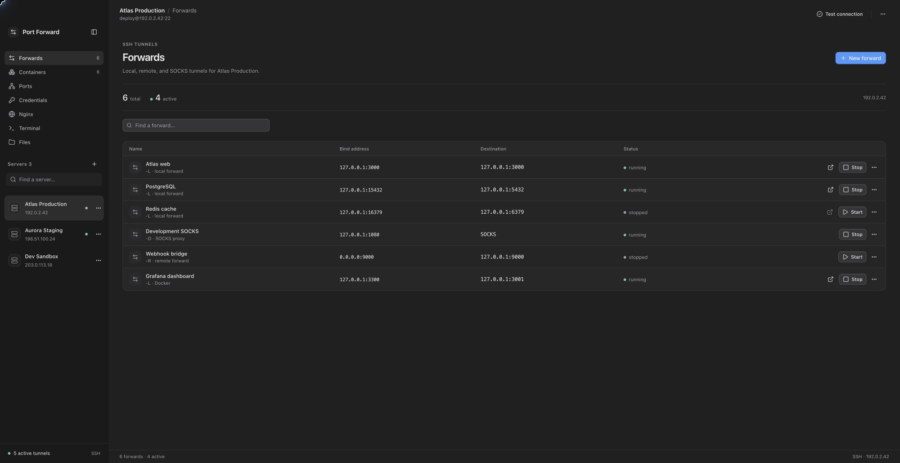
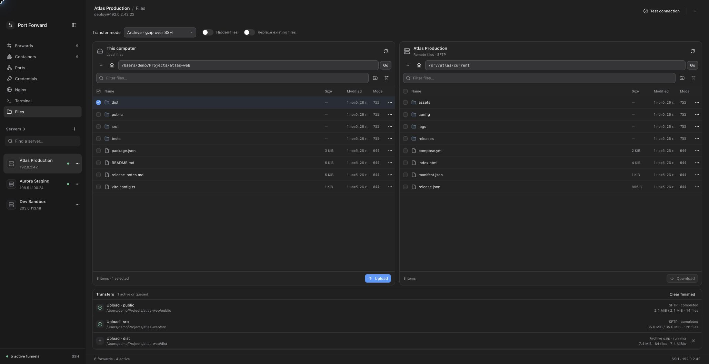
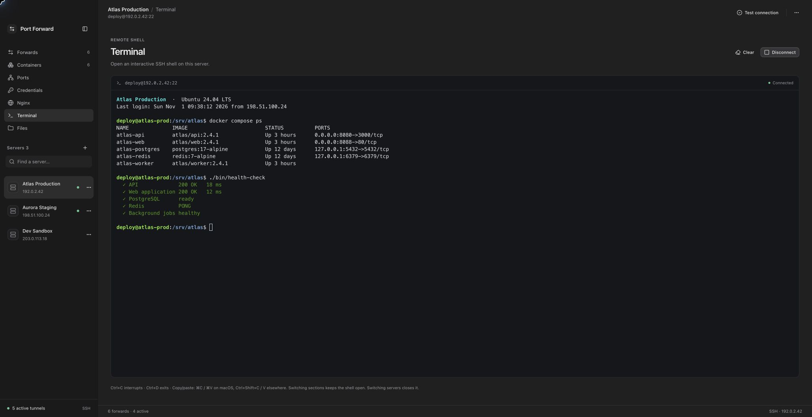
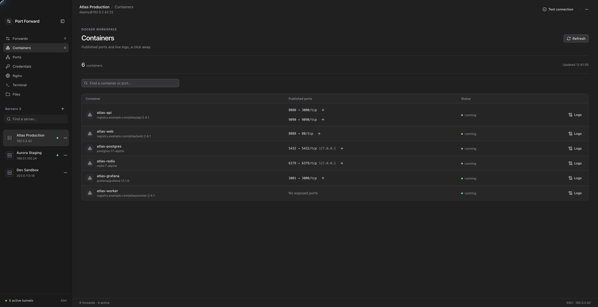
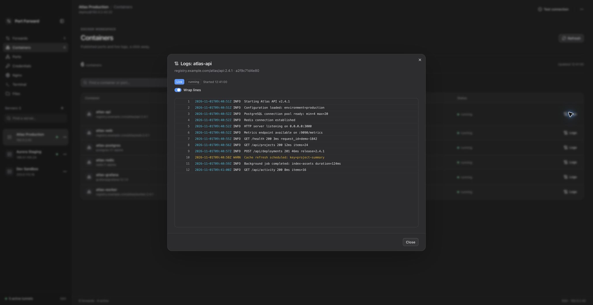
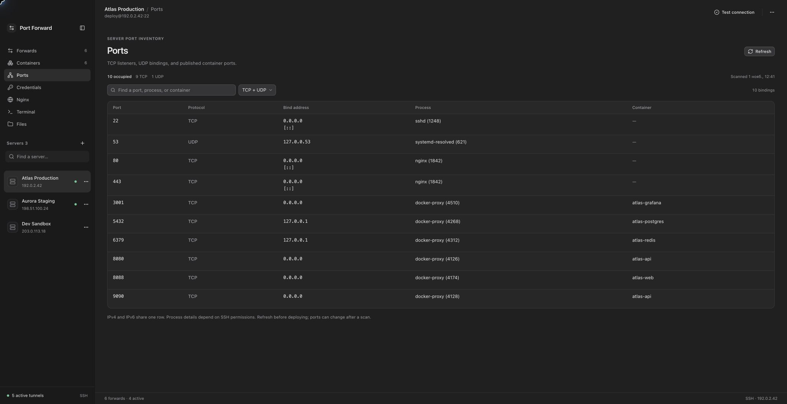
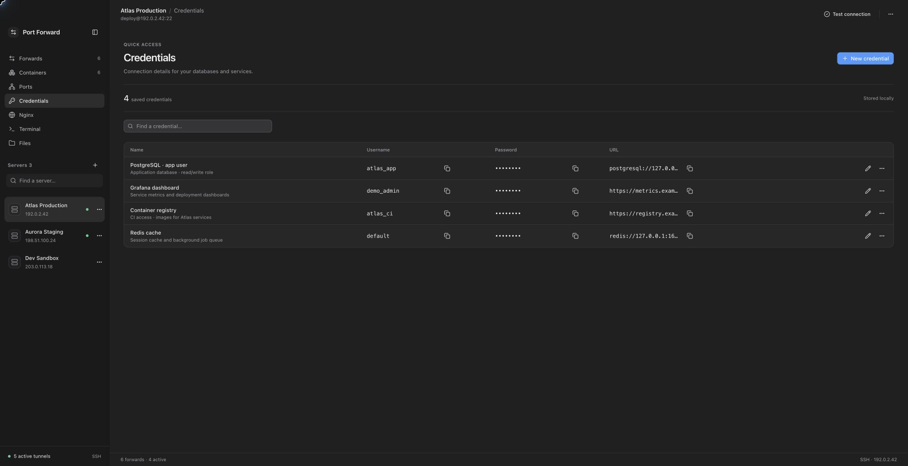
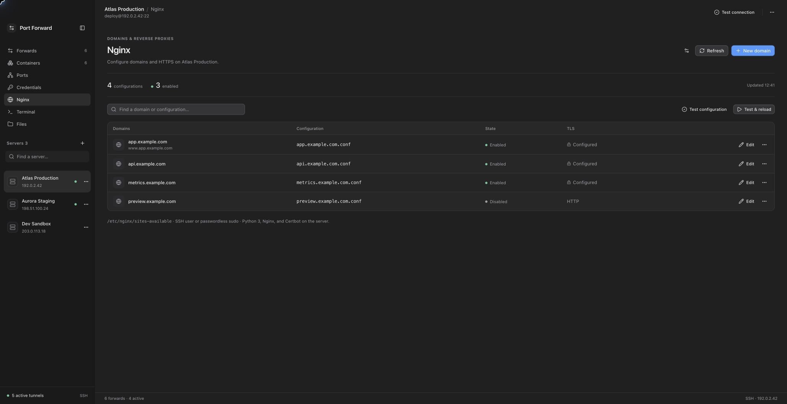
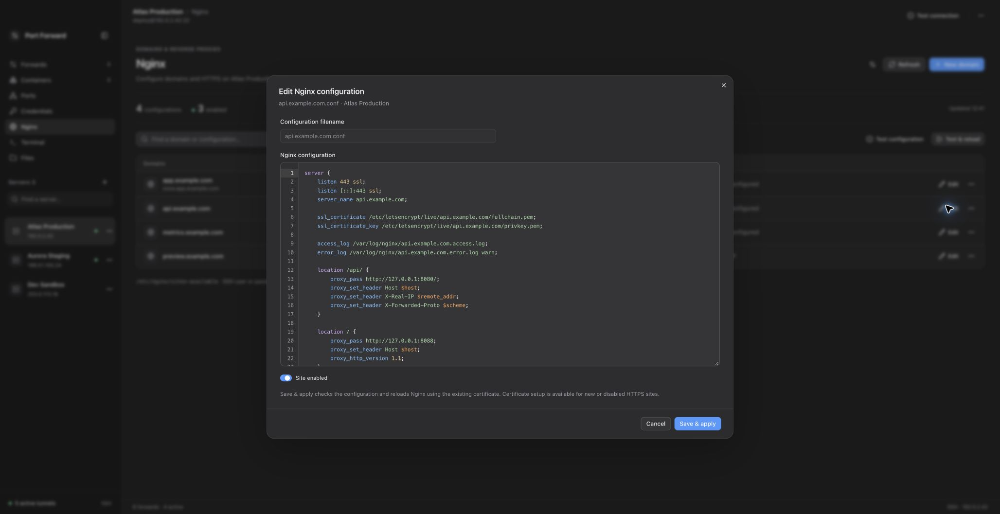

# Port Forward

A desktop SSH tunnel manager built with Tauri, React, and Rust. The app keeps SSH server profiles, starts local, remote, and dynamic/SOCKS forwards, creates quick access to published Docker ports, and streams container logs over SSH.

## Features

- SSH profiles with SSH agent, private key file, or password authentication.
- Interactive SSH terminal with a remote PTY, ANSI colors, terminal resizing, and bounded streaming output.
- Two-pane local/SFTP file manager with recursive transfers, a cancellable queue, text editing, and optional streaming tar/gzip over SSH.
- Manual tunnel configurations for `-L`, `-R`, and `-D`.
- Runtime tunnel states: `starting`, `running`, `reconnecting`, `stopping`, `stopped`, `failed`.
- Automatic fallback for local and dynamic ports: if the requested port is busy, the app tries a free port from `50000-58000` and shows the actual runtime bind.
- Docker discovery for the selected server via `docker ps` and `docker inspect`.
- Occupied server ports with TCP/UDP filters, process and container details, and port search.
- Nginx site editing, duplication, enable/disable, and domain setup with Certbot webroot certificates.
- Quick local forward creation for published Docker ports.
- `docker logs` viewing with an initial tail and live follow.
- Local storage for servers, forwards, Docker cache, and credential notes.
- macOS Dock badge with the number of active tunnels.
- A compact macOS-style workspace with system light/dark appearance, searchable sections, and keyboard shortcuts.

## Screenshots

All screenshots use generated demo data: fictional servers, services, credentials, files, and logs. Click an image to view it at full size.

**SSH tunnels** — local, remote, and SOCKS forwards with runtime status.

[](docs/screenshots/forwards.jpg)

| Workspaces | Tools |
| --- | --- |
| [](docs/screenshots/files.jpg)<br>**SFTP files and transfer queue** | [](docs/screenshots/terminal.jpg)<br>**Interactive SSH terminal** |
| [](docs/screenshots/containers.jpg)<br>**Docker containers and published ports** | [](docs/screenshots/container-logs.jpg)<br>**Container logs** |
| [](docs/screenshots/ports.jpg)<br>**Occupied ports** | [](docs/screenshots/credentials.jpg)<br>**Service credentials** |
| [](docs/screenshots/nginx-sites.jpg)<br>**Nginx domains and HTTPS** | [](docs/screenshots/nginx-editor.jpg)<br>**Nginx configuration editor** |

## Tech Stack

- Frontend: React 19, TypeScript, Vite, Tailwind CSS 4, shadcn/ui-style components.
- Desktop/runtime: Tauri 2.
- Backend: Rust, `ssh2`, Tauri commands.
- Bundles: macOS `.app` and `.dmg`.

## Requirements

- Node.js and Yarn.
- Rust stable and Cargo.
- Tauri platform prerequisites for your OS. On macOS, this usually means Xcode Command Line Tools.
- SSH access to the servers you want to configure.
- For the Docker section: Docker installed on the remote server and user permissions to run `docker ps`, `docker inspect`, and `docker logs`.
- For Nginx management: a Linux server with Python 3, Nginx, a `sites-available`/`sites-enabled` layout, and root access or passwordless `sudo`. Certificate issuance also requires Certbot, domain DNS pointing to the server, and inbound HTTP port 80 reachable by Let's Encrypt.

## Quick Start

```bash
yarn install
yarn tauri dev
```

`yarn tauri dev` starts the Vite dev server at `http://localhost:1420` and opens the Tauri desktop shell. Plain `yarn dev` starts only the browser frontend; Tauri IPC commands are not available there, so real SSH and Docker operations will not work.

## Common Commands

```bash
# Frontend build
yarn build

# Desktop dev app
yarn tauri dev

# Production bundle
yarn tauri build

# Rust checks
cd src-tauri
cargo fmt --check
cargo check
cargo test
```

Nginx feature checks from the project root:

```bash
yarn test:nginx
yarn test:nginx:remote
# Optional: requires a locally cached nginx:latest Docker image; no image is pulled
yarn test:nginx:config
```

The remote-helper tests use temporary directories and fake executables. The Docker check uses temporary certificate fixtures and an isolated, read-only container; neither check changes a configured SSH server or issues a public certificate.

After `yarn tauri build`, build artifacts are written under `src-tauri/target/release/bundle/`.

## Usage

1. Add a server profile with `Add server`: host, port, username, and authentication method.
2. Verify the profile with `Test connection`.
3. Select `Forwards` in the sidebar and choose `New forward`.
4. Start it with `Start`.
5. For a local forward, use the `Open in browser` icon to open `http://<bindHost>:<bindPort>`.

Use the sidebar to switch between Forwards, Containers, Ports, Credentials, Nginx, Terminal, and Files for the selected server. Server actions are available from each server's More menu. Docker containers appear once, with their published ports grouped in the same row.

### Keyboard Shortcuts

| Shortcut | Action |
| --- | --- |
| `⌘1`–`⌘7` | Switch workspace section |
| `⌘N` | New forward, credential, or Nginx domain in the current section |
| `⇧⌘N` | Add server |
| `⌘F` | Focus the current section's search field |
| `⌘B` | Show or hide the sidebar |

Shortcuts also accept Ctrl on other platforms and are suspended while a dialog is open. The interface follows the system's light/dark appearance, reduced-motion, transparency, and contrast preferences.

## SSH Terminal

Open **Terminal** (`⌘6`) and choose **Connect** to start an interactive shell using the selected server's saved authentication and existing host-key checks. The terminal uses `@xterm/xterm` with `@xterm/addon-fit`; Rust requests an `xterm-256color` PTY through the existing `ssh2` transport. Ordered Tauri Channels carry raw output bytes, and acknowledgements after terminal parsing limit buffered output. No additional WebSocket server or remote software is required.

Arrow keys, ANSI colors, Ctrl+C, Ctrl+D, shell prompts, and full-screen terminal applications use the remote PTY. The remote terminal size follows the workspace. Copy and paste use `⌘C` / `⌘V` on macOS and `Ctrl+Shift+C` / `Ctrl+Shift+V` elsewhere; Ctrl+C is sent to the remote shell. **Clear** clears scrollback. **Disconnect** closes the SSH session, and **Reconnect** starts a new shell without replaying previous input.

Switching workspace sections keeps the shell open. Selecting another server, editing its connection settings, deleting it, or quitting the app closes the session. Terminal output and typed input are not saved by the app; the remote shell may maintain its own history. The browser-only Vite preview cannot open SSH sessions.

Terminal input checks:

```bash
yarn test:terminal
```

### Forward Types

`-L` local forward:

```text
local bindHost:bindPort -> targetHost:targetPort through the SSH server
```

Use this to access a service from your local machine when that service is reachable from the server.

`-R` remote forward:

```text
remote bindHost:bindPort -> local targetHost:targetPort
```

Opens a listener on the remote server and forwards incoming connections back to a local target.

`-D` dynamic forward:

```text
local bindHost:bindPort -> SOCKS5 proxy through the SSH server
```

Supports SOCKS5 `CONNECT` requests without authentication.

### Autostart

The `Autostart` flag currently starts a forward immediately after saving it. Saved forwards are not automatically started when the app launches.

## SFTP Files

Open **Files** (`⌘7`) to browse this computer and the selected SSH server side by side. The remote pane uses SFTP with the profile's existing authentication and host-key verification. Enter an absolute path or use the parent/home buttons, filter filenames, and enable **Hidden files** when needed. Click an entry to select it; double-click a folder or press Enter to open it. Checkboxes and Cmd/Ctrl-click select multiple entries. **Upload** and **Download** copy the selection into the opposite pane's current directory, keeping each selected entry's name. You can also drag files or folders to the opposite pane or onto a folder inside it; dragging a selected entry copies the whole selection using the current transfer mode and replacement setting.

Each pane supports creating folders, renaming, confirmed recursive deletion, octal permissions, and editing UTF-8 text files up to 2 MiB. Saving checks the file revision to reject changes made since the file was opened. File writes use temporary files and atomic publication. Symlinks are visible and can be renamed or deleted, but transfers do not follow them; special files are unsupported. Regular permissions and modification times are retained without copying ownership or special permission bits.

Transfers run sequentially in an in-memory queue with byte counts, speed, errors, and cancellation. Changing the selected server, editing its connection profile, reloading the UI, or quitting cancels its transfers. Switching workspace sections keeps them running. There is no automatic retry or resume. Completed files remain when a later file fails or a transfer is cancelled; an incomplete file does not replace its destination. The queue is not saved between launches.

Existing destinations are refused by default. Enable **Replace existing files** explicitly to replace regular files. Remote replacement, including saving an edited remote text file, requires the server's `posix-rename@openssh.com` extension; unsupported servers fail without deleting the destination. SFTP can also merge into an existing directory with replacement enabled; existing unrelated entries are retained. Archive mode refuses an existing destination directory, including when replacement is enabled. A transfer containing several selected entries can publish some complete entries before a later publication fails.

**Transfer mode → Archive · gzip over SSH** implements a streamed equivalent of `tar | ssh | tar` in both directions. It packs and compresses while sending, then decompresses and extracts at the destination. No archive file is created. The server must provide `tar` with gzip support and permit an SSH command channel; an SFTP-only account can use the ordinary SFTP mode. The app does not install server packages or fall back after a partially executed transfer.

Archive mode can help with many small files and compressible data, but its performance depends on CPU, network latency, and content. It uses gzip rather than bzip2, with fast compression on uploads. Already compressed files may gain little. Its progress counts compressed network bytes and has no known total or percentage. Extraction uses a private hidden staging directory on the destination filesystem, so free space is required for the extracted data before publication. Interrupted staging is removed on a best-effort basis; if cleanup fails, the error includes its `.port-forward-*` path. Archive download rejects unsafe paths, symlinks, and special entries; regular hard links inside the selected roots are accepted.

Frontend helper checks:

```bash
node --test tests/sftp.test.mjs
```

Opt-in real SSH/SFTP tests create an ephemeral loopback-only `sshd`, temporary host/user keys, pinned fixture `known_hosts`, and test data. They verify both transfer modes in both directions, byte equality, empty entries, restrictive directory permissions, conflicts, file actions, and cancellation. They never use saved application profiles or personal SSH key files. The fixture stops its daemon and removes its keys when finished. OpenSSH `sshd`, `ssh-keygen`, Python 3, and Cargo are required; macOS may require running the command outside a restricted process sandbox.

```bash
python3 src-tauri/tests/run_sftp_loopback.py
```

These tests are ignored by the default `cargo test` run and must be requested through the fixture runner.

## Occupied Ports

Use **Scan ports** in the **Ports** section for the selected server before choosing a port for a new service. The scan reads TCP listeners and bound UDP sockets through Linux `ss` (from `iproute2`), then adds current Docker published ports, including NAT bindings without a listening `docker-proxy` socket.

Each port and protocol appears once, with its IPv4/IPv6 bind addresses, available process names/PIDs, and container names. Search by a port number for an exact match, or by address, process, or container; use the protocol filter to distinguish TCP from UDP.

Results are a timestamped snapshot. Refresh before deployment: a missing binding does not reserve or guarantee availability of that port. Missing tools, Docker access failures, and unavailable process details are reported in the block. Scans use the configured SSH user without requesting elevated privileges and are not persisted.

## Docker

The `Refresh` button in the `Containers` section connects to the selected server and runs:

```bash
docker ps -q
docker inspect <container_ids>
```

The result is cached in the local `state.json`. For containers with published ports, the `Add` button creates a local forward with source `docker`.

The `Logs` button first reads the latest 1000 lines:

```bash
docker logs --tail 1000 <container_id> 2>&1
```

Then it opens a live follow session:

```bash
docker logs --tail 0 -f <container_id> 2>&1
```

## Nginx Domains

Open **Nginx** for the selected SSH server and choose **Refresh** to load its site files. The default layout is `/etc/nginx/sites-available` with symlinks in `/etc/nginx/sites-enabled`. The settings button lets you change the Nginx directory and ACME webroot, and choose whether to use noninteractive `sudo` for a non-root SSH user. These preferences are saved per server. The app does not install remote packages or ask for a sudo password.

**New domain** opens a form for the primary domain, additional names, certificate email, and proxy locations. Each location has an upstream HTTP(S) origin and an explicit option to remove its path prefix. For example, `/b/` with prefix removal forwards `/b/users` to `/users`; with preservation it forwards `/b/users` unchanged. The default template matches the supplied `nginxconfig.io` layout. Turn off shared includes if those snippets are not installed on the server.

Review and edit the full generated configuration before applying it. **Save draft** writes a disabled file without enabling or syntax-testing that draft. **Issue certificate & enable HTTPS** runs the complete setup:

1. Check that the domain is not already enabled in another site and that the target file has not changed.
2. Back up the existing file and enabled symlinks under `<nginx directory>/.port-forward-backups`.
3. Write an HTTP-only site with an explicit ACME challenge location using the configured webroot, then enable it with a symlink.
4. Run `nginx -t`, confirm the site is actually included by Nginx, and send a reload signal.
5. Run `certbot certonly --webroot` with the requested domains, email, webroot, and explicit certificate name. Existing certificates are kept until renewal is needed; force renewal is an explicit option. Certificate issuance accepts the Let's Encrypt subscriber agreement.
6. Write the reviewed HTTPS configuration, test it, and reload Nginx again.

On a handled failure, the helper restores the previous site file and symlinks and, when needed, reloads that restored configuration. Operation output and backup paths remain visible in the app. Certificates already issued by Certbot are not deleted or revoked during rollback. An existing enabled TLS site uses **Save & apply** for configuration changes; the bootstrap workflow does not silently remove working HTTPS.

Existing sites can be edited as raw Nginx configuration, duplicated with domain replacement, enabled, or disabled. The editor highlights Nginx directives, variables, strings, numbers, and comments, follows the system appearance, and provides line numbers, bracket matching, and undo/redo. The raw editor preserves directives that the new-domain form does not model. Review copied aliases, certificate paths, upstream ports, and locations before applying a duplicate. The separate **Test configuration** and **Test & reload** actions show command output. A successful reload command confirms the signal was sent, not an external health check of the service.

Mutating operations are serialized on the server, use atomic file replacement, and reject changed revisions, path traversal, and conflicting enabled entries. While an operation is running, the app prevents switching or editing the SSH server. Unsupported site layouts, missing tools, and permission errors are reported without automatically installing or changing server-wide settings.

Domain DNS and HTTP port 80 must be reachable before issuance. Keep the ACME challenge location available for future renewals. Certbot's existing timer/cron configuration remains responsible for automatic renewal; configure its deploy hook to test and reload Nginx after a successful renewal if your installation does not already do so. See the [Certbot webroot and renewal guidance](https://eff-certbot.readthedocs.io/en/stable/using.html#webroot) and [Nginx reload documentation](https://nginx.org/en/docs/control.html).

## Local Data and Security

The app stores state in the Tauri app data directory in a `state.json` file. It contains:

- server profiles;
- forwards;
- Docker cache;
- saved secrets and passwords entered in the UI;
- SSH passwords/passphrases when the corresponding authentication method is used.

The file is not encrypted and is not stored in the OS keychain. Do not store secrets there unless your local user profile and disk are protected at the OS level.

When connecting over SSH, the app checks `~/.ssh/known_hosts` if the file exists. A host key mismatch stops the connection.

## Project Structure

```text
src/
  App.tsx              React UI, Tauri IPC calls, Docker log events
  components/ui/       UI primitives
  index.css            Tailwind/theme styles

src-tauri/
  tauri.conf.json      Tauri config and bundle settings
  capabilities/        Tauri permissions
  src/
    commands.rs        Tauri command handlers
    models.rs          Shared serializable DTOs
    ssh.rs             SSH connection, auth, Docker discovery
    tunnel.rs          Local, remote and dynamic forwarding runtime
    docker_logs.rs     Docker log sessions and event emission
    terminal.rs        Interactive SSH PTY sessions and bounded terminal I/O
    sftp.rs            Local/SFTP file actions, recursive transfers, cancellation
    sftp_archive.rs    Streamed tar/gzip SSH transport and safe staged extraction
    sftp_rename.rs     Bounded OpenSSH atomic rename extension helper
    nginx.rs           Nginx commands and SSH transport for site management
    nginx_remote.py    Remote Nginx transactions, backups, Certbot workflow
    storage.rs         state.json persistence
    dock.rs            macOS Dock badge
    lib.rs             Tauri app setup and plugin registration
```

## Debug Automation

Debug builds register `tauri-plugin-mcp-bridge`; release builds do not include it. The project enables `withGlobalTauri` and the `mcp-bridge:default` permission for this.

## Troubleshooting

- `Tauri runtime is required for backend commands`: the app was opened through `yarn dev` in a browser. Run `yarn tauri dev`.
- `Host key mismatch`: the server key differs from the entry in `~/.ssh/known_hosts`; verify the server and update known_hosts manually.
- `Local port ... is unavailable`: the port is busy. For local and dynamic forwards, the app tries fallback ports from `50000-58000`; if no free port is available, the tunnel will not start.
- Empty Docker section: the server has no running containers, Docker is not installed, or the user does not have permission to use the Docker CLI.
- `Password authentication selected but no password was provided`: the profile uses password authentication but was saved without a password.
